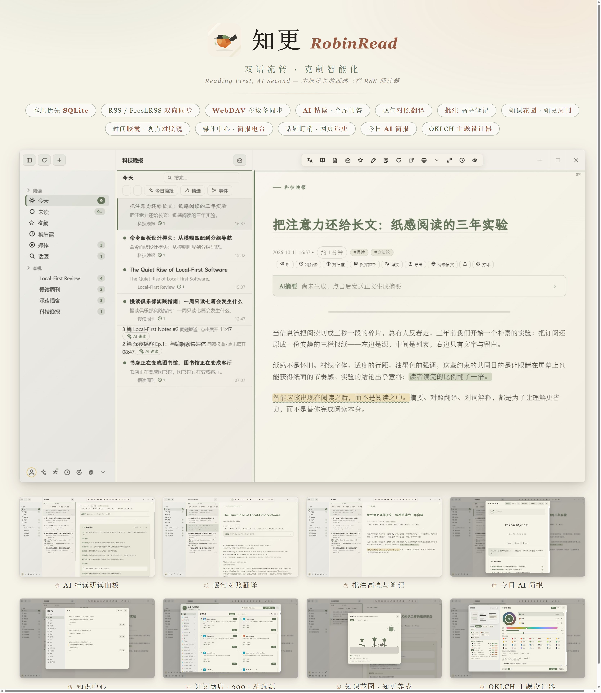
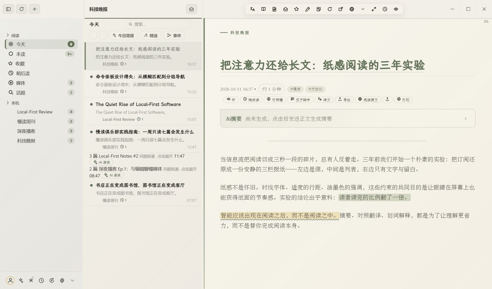
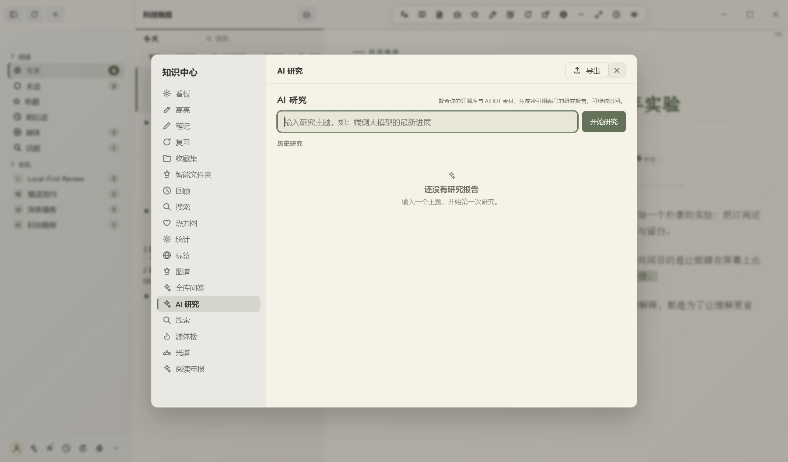
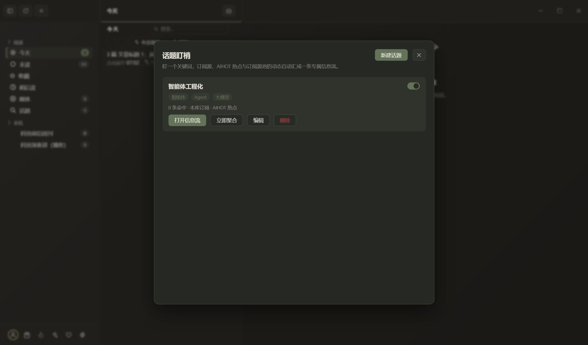
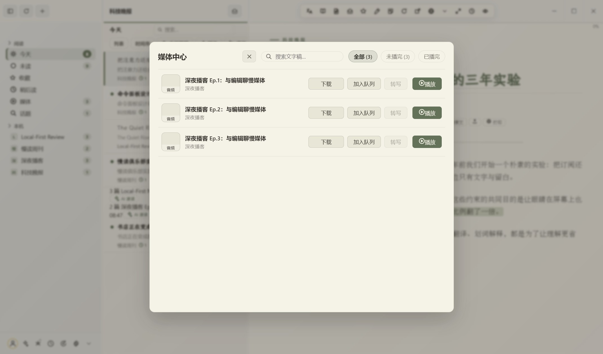
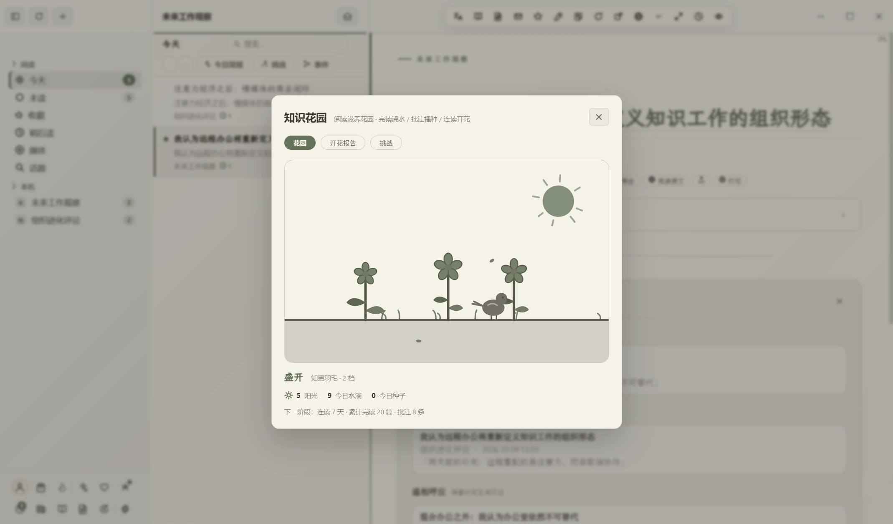
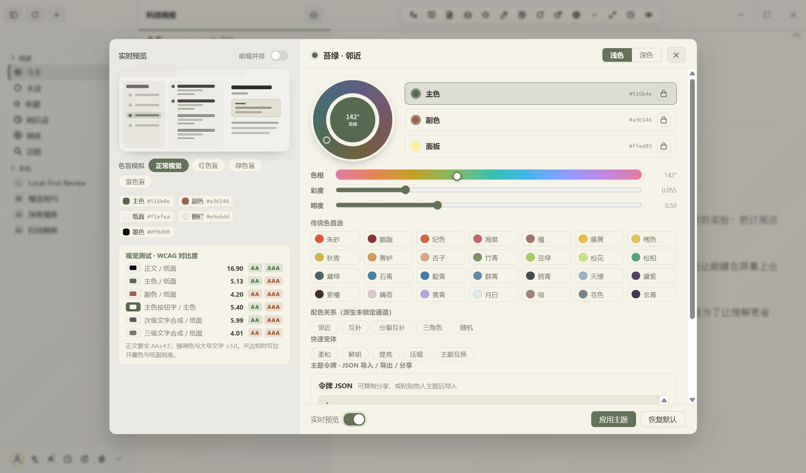

<div align="center">

  

  # 知更 RobinRead

  ***双语流转，克制智能化。Reading First, AI Second.***

  本地优先、AI 增强的纸感三栏 RSS 阅读器（Windows / Electron）

  [](https://github.com/suzike/RobinRead/releases/latest)
  [](LICENSE)
  [](https://github.com/suzike/RobinRead/releases/latest)
  [](https://www.electronjs.org/)
  [](https://ronbinread-d9gmsqi2vc0a18f04-1401273698.tcloudbaseapp.com/)

  [官方网站](https://ronbinread-d9gmsqi2vc0a18f04-1401273698.tcloudbaseapp.com/) · [下载安装](#-下载安装) · [更新日志](CHANGELOG.md) · [问题反馈](../../issues)

</div>

---

## 这是什么

知更（RobinRead）把散落的订阅还原为一个安静、清晰的三栏阅读空间：左侧订阅、中间文章列表、右侧衬线排版的阅读区。数据全部保存在本机（SQLite），不经过任何第三方服务器；AI 只在真正有帮助的地方出现——摘要、对照翻译、划词解释、批注辅助，而不是替你阅读。

## ✨ 功能一览

### 沉浸阅读

<div align="center"></div>

- 三栏纸感布局、衬线排版、纸纹噪点，明暗两套默认主题
- **沉浸杂志视图**：列表 ⇄ 封面卡片杂志一键切换；**期刊双页翻页**：拖拽折页、翻页纸声、目录滑轨、页码预览
- **报纸级中文排版引擎**：盘古之白、行首行尾标点挤压、首字下沉、段式 / 字距 / 栏宽 / 页边全可调，每源可单独覆盖；内置霞鹜文楷与得意黑，无需安装字体
- **每日刊头**：订阅自动排版成「一期」——封面故事、按来源分栏的本期目录；整期 / 单篇一键导出 EPUB
- 网页正文一键重排（内置 Readability），烂排版、反爬壳页也能读；阅读位置记忆、禅模式、`Ctrl+F` 全文搜索

### AI 精读与问答

<div align="center"></div>

- **AI 研读面板**：流式生成主旨、论证脉络、关键概念、另一面；全文摘要折叠卡，读完要点再决定要不要精读
- **逐句对照翻译**：原文与中文并排显示，每个订阅源可单独设置总是 / 从不翻译；划词即问：解释、翻译、多轮追问
- **AI 深度研究 · 全库问答**：聚合订阅库生成带引用编号的研究报告，多轮问答引用可跳回原文；未配 Key 自动降级纯检索
- **批注**：五种纸感色高亮、段落便签、批注总览；**同题 AI 对比速读**多源报道；AI 自动标签
- 模型接入：DeepSeek / 任意 OpenAI 兼容 API / 可信局域网服务；API Key 走 Windows DPAPI 加密，不出本机

### 发现与订阅

<div align="center"></div>

- **订阅商店**：300+ 精选源、12 个分类（160+ 中文独立博客），一键订阅；**AI 探索**输入关键词，AI 去全网发现目录之外的新源
- **AIHOT 热点中心**：全网 AI 热点榜、AI 日报、大模型综合榜；关注关键词自动盯梢
- **话题盯梢 · 网页追更**：盯一个关键词，订阅源 + 热点三路动态汇成专属信息流；没有 RSS 的页面给网址 + CSS 选择器即可订阅，内容变化段落级高亮
- **中文平台订阅**：B 站 UP 主投稿、微博时间线转订阅流；Newsletter 邮箱（IMAP）按发件人白名单转文章
- **智能每日精选**：本地阅读画像毫秒级重排，读得越多越懂你；相关文章与线索视图自动串联同话题

### 听与媒体

<div align="center"></div>

- **媒体中心**：带音频 / 视频附件的文章自动入库，播放、下载、队列一处搞定；视频在阅读器内嵌播放
- **迷你播放器**：倍速、±15 秒跳转、队列连播、进度记忆
- **简报电台**：每日 AI 简报一键转成语音节目，分句链播、断点续听
- **神经语音朗读**：微软 Neural 真人音色按句跟随高亮（`R` 读 / 停），也支持接入自定义 TTS 服务

### 知识与记忆

<div align="center"></div>

- **知识中心**：标签云、知识图谱、SM-2 复习卡片、年度热力图；**问知识库**以你的高亮与笔记为材料作答，引用可跳回来源
- **知识花园 · 阅读挑战**：每读完一篇浇一次水，断读会枯萎、回读能复活，从种子长到满园；主题书单挑战赛季读满结算限定装饰
- **知更周刊 · 课程引擎**：每周一自动把上周阅读编成报纸版面的周刊（可导出 EPUB）；把任意标签编成多日课程，按天解锁
- **时间胶囊 · 批注漂流瓶**：把高亮 / 笔记封进胶囊，到期开启仪式重现当年心境；批注漂出去，别人的批注漂进来
- **观点对照镜 · 重访 · 生物钟**：旧文自动三路对照（唱反调 / 相辅相成 / 遥相呼应）点破立场变迁；长文按遗忘曲线排队重访；简报顶部一条阅读高峰提示
- **知识输出**：Obsidian Markdown 库导出（增量同步）、个人文集自动成书 EPUB

### 主题与分享

<div align="center"></div>

- **OKLCH 主题设计器**：30+ 中国传统色、季节套包一键成套、色觉障碍模拟、WCAG 对比度实时检测、主题令牌 JSON 导入导出
- **精读卡片一键导出**：精读笔记 / 摘要一键生成高清卡片图（六款模板、画幅自适应），保存 PNG 或直接复制分享
- **设置中心 2.0**：全屏分区导航 + 搜索过滤；**WebDAV 多设备同步**：订阅、进度、批注经坚果云等漫游，本地优先合并
- 还有：全文抓取引擎、规则过滤引擎、多窗并读、阅读目标与专注会话、系统托盘常驻、备份恢复、保留期自动清理

<details>
<summary><strong>⌨️ 键盘快捷键</strong>（点击展开）</summary>

| 键 | 动作 |
| --- | --- |
| `C` | 开启 / 关闭逐句对照翻译 |
| `V` | 查看 / 生成 AI 摘要 |
| `H` | 快速黄色高亮 |
| `B` `B` | 上一篇（再按一次确认，不循环） |
| `N` `N` | 下一篇（再按一次确认，不循环） |
| `M` | 收藏 / 取消收藏 |
| `R` | 开始 / 停止朗读 |
| `F` | 聚焦模式：非当前段落渐暗，指针所在段保持清晰 |
| `Space` | 向下阅读；到底后切换下一篇 |
| `←` `→` | 三栏之间移动焦点 |
| `Ctrl+Shift+P` | 命令面板：搜索并执行任意功能 |
| `Ctrl+F` | 搜索正文：高亮全部命中，Enter 跳转 |
| `Ctrl+Shift+R` | 刷新全部订阅 |
| `Ctrl + = / − / 0` | 正文字号 放大 / 缩小 / 重置 |
| `Ctrl+/` | 快捷键帮助 |

</details>

## 📥 下载安装

前往 [**Releases**](https://github.com/suzike/RobinRead/releases/latest) 下载：

| 文件 | 说明 |
| --- | --- |
| `RobinRead-x.y.z-setup.exe` | 安装版，支持自定义安装目录 |
| `RobinRead-x.y.z-portable.exe` | 便携版，解压即用，不写注册表 |

也可以在[官方网站](https://ronbinread-d9gmsqi2vc0a18f04-1401273698.tcloudbaseapp.com/)下载（附 SHA-256 校验值）。

> 全部功能免费开放：订阅源数量与 AI 调用均不限量，无需登录即可使用完整功能（账号体系保留，登录后可同步激活记录）。

系统要求：Windows 10 / 11（x64）。

## 🛠 从源码运行

要求：Node.js 20+（建议 22+）、npm。

```bash
git clone https://github.com/suzike/RobinRead.git
cd RobinRead
npm install
npm start          # 开发运行
npm run dist       # 打包 Windows 安装包 + 便携版（输出到 dist/）
```

首次运行会自动创建本地账户；在工具栏「+」添加 RSS 订阅或导入 OPML，在「设置 → 账号」绑定 FreshRSS，在「设置 → AI 功能」配置 API Key 后启用 AI 能力。

<details>
<summary><strong>📁 目录结构</strong>（点击展开）</summary>

```
src/
  main/                     # Electron 主进程
    AppStore.js             # 业务中枢
    Models.js               # 数据模型与纯函数
    FeedParser.js           # RSS / Atom / JSON Feed 解析
    FeedService.js          # ETag 条件抓取
    OPMLService.js          # OPML 导入导出
    ArticleExtractor.js     # 网页正文提取 + HTML 白名单消毒
    LLMService.js           # OpenAI 兼容流式客户端 + ArticleChunker
    AihotService.js         # AIHOT 热点/日报/精选/模型榜
    KnowledgeEngine.js      # 知识中心
    EvolutionEngine.js      # 阅读进化
    I18N.js / I18NStrings.js# 中英双语
    UpdateCheckService.js   # 更新检查（默认离线，可自建更新源）
    Account/                # 凭据存储（DPAPI/safeStorage）
    FreshRSS/               # Google Reader API 客户端与认证
    Persistence/            # SQLite（node:sqlite）+ 迁移 + 仓库 + TimelineQueryService
  renderer/                 # 三栏 UI
    views/                  # sidebar / list / reader / settings / store / aihot / knowledge
    styles/robin.css        # 纸感主题（OKLCH 变量驱动）
scripts/
  selftest.js               # 自检（解析/持久化/查询/消毒/UI）
  uitest.js                 # 端到端 UI 交互测试
  verify-realrun.js         # 真机可视全量回归（生产数据副本 + 截图取证）
server/                     # 本地联调服务器（会员/激活 API 的零依赖 mock）
cloudfunctions/njpaper-api  # 云函数版后端（微信登录 / 支付 / 激活码）
website/                    # 官网源码（CloudBase 静态托管）
```

</details>

## 🔒 数据与隐私

订阅、文章、阅读状态、批注、AI 配置全部保存在 `%APPDATA%\RobinRead`，卸载不残留云端副本。从旧版本升级时，数据会在首次启动自动迁移，不覆盖新数据。AI 调用直连你配置的模型服务商，本应用不经手、不存储。

## 🏷 版本记录

版本以 GitHub Release 标签管理，与应用版本号保持一致，发布页附带安装包与 SHA-256：

- **[v2.15.0 — 体验细节 20 轮：顶级体验官 × Apple 设计师纪律](https://github.com/suzike/RobinRead/releases/tag/v2.15.0)**（2026-10-12）：R54-R73 三连制细节打磨——浮层秩序（Esc 逐层裁决/焦点归还）、toast 秩序（堆叠合并/重试动作）、阅读开卷体验、暗色对比度实算全过 AA、滚动锚定代际作废、错误可重试、冷启动骨架先行等 60 项；探针门禁 118 → 138 项，四批独立审查收口 6 P1 + 5 P2
- **[v2.14.1 — 实机反馈：侧栏底栏收敛](https://github.com/suzike/RobinRead/releases/tag/v2.14.1)**（2026-10-11）：侧栏底栏 12 键收敛为「一行 7 键 + 更多展开行」，花园 / 胶囊 / 重访徽标提醒保持外显
- **[v2.14.0 — 创意功能 20 项 + 视觉焕新 20 项](https://github.com/suzike/RobinRead/releases/tag/v2.14.0)**（2026-10-11）：知识花园、观点对照镜、知更周刊、时间胶囊、课程引擎、阅读挑战、语音舱、Local REST API 等 20 项新功能与全应用视觉焕新；顺手修复周刊弹窗两列布局、简报目标环脱位两个真 bug
- **[v2.13.0 — 大迭代：20 大功能 + 20 大视觉升级](https://github.com/suzike/RobinRead/releases/tag/v2.13.0)**（2026-10-09）：媒体中心、话题盯梢、网页追更、Newsletter 订阅、WebDAV 同步、AI 深度研究、全库问答、智能每日精选、Obsidian 导出、文集成书等 20 项功能与 20 项视觉升级

完整版本历史见 [CHANGELOG.md](CHANGELOG.md)，每个版本的安装包都在 [Releases](https://github.com/suzike/RobinRead/releases) 页。

## 📄 许可证

本项目基于 [GPL-3.0](LICENSE) 协议开源，欢迎自由使用、修改与二次分发。

<div align="center">
  <sub><a href="https://ronbinread-d9gmsqi2vc0a18f04-1401273698.tcloudbaseapp.com/">ronbinread · tcloudbaseapp.com</a> — 双语流转，克制智能化</sub>
</div>
